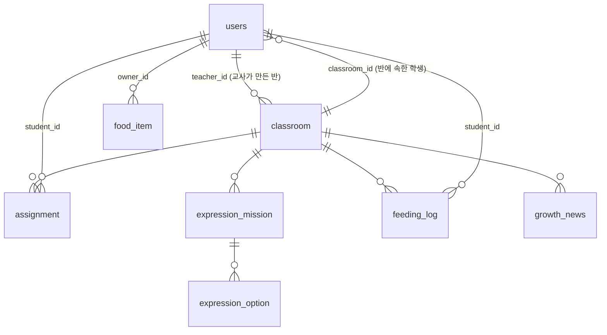

# 데이터베이스 운영 가이드 (Supabase PostgreSQL)

이 문서만 보고도 공용 DB 의 데이터를 확인·수정하고 유지보수할 수 있도록 정리했습니다.

- DB: **Supabase PostgreSQL** (프로젝트 `class-task-monster`, 리전 Seoul `ap-northeast-2`)
- 스키마 관리: **Flyway** (`backend/src/main/resources/db/migration`)
- 접속 정보: 루트 `.env` (git 제외). **비밀번호는 채팅·문서·커밋에 쓰지 않습니다.**

---

## 1. 접속하기

### 1-1. 웹 대시보드 (가장 쉬움)
Supabase 대시보드 → 왼쪽 메뉴

| 메뉴 | 용도 |
|---|---|
| **Table Editor** | 엑셀처럼 데이터 보기·수정·추가·삭제. 컬럼에 마우스를 올리면 설명(COMMENT)이 보입니다 |
| **SQL Editor** | 아래 [자주 쓰는 SQL](#4-자주-쓰는-sql) 실행 |
| Database → Backups | 백업 확인 (무료 플랜은 제한적, [백업](#6-백업) 참고) |

### 1-2. 백엔드를 공용 DB 에 붙이기 (`remote` 프로필)
1. 대시보드 상단 **[Connect]** → **Session pooler** 탭의 값을 확인
2. 루트 `.env` 에 입력 (`.env.example` 참고)
   ```
   DB_URL=jdbc:postgresql://<Session pooler Host>:5432/postgres?sslmode=require
   DB_USERNAME=postgres.<프로젝트 ref>
   DB_PASSWORD=<DB 비밀번호>
   ```
3. 실행: `cd backend && ./gradlew bootRun --args='--spring.profiles.active=remote'`
   - 처음 실행 시 Flyway 가 테이블을 만들고(V1, V2), 이후에는 새 마이그레이션만 적용합니다.
4. **최초 1회 설정** — 처음 실행으로 테이블이 생긴 뒤, Supabase **SQL Editor** 에서 한 번 실행합니다.
   ```sql
   -- Flyway 이력 테이블도 Supabase Data API(anon 키)에서 보이지 않도록 차단
   ALTER TABLE public.flyway_schema_history ENABLE ROW LEVEL SECURITY;
   ```
   (나머지 테이블의 RLS 는 V2 마이그레이션이 자동으로 켭니다. 이 테이블만 마이그레이션 도중 잠겨 있어 따로 실행합니다.)

> **Session pooler 를 쓰는 이유**: Direct connection(`db.<ref>.supabase.co`)은 IPv6 전용이라 학교·회사 네트워크에서 접속이 안 될 수 있고,
> Transaction pooler(6543 포트)는 JDBC 와 충돌할 수 있습니다.

### 1-3. DBeaver 로 접속하기 (권장 DB 툴)

**설치**: [dbeaver.io](https://dbeaver.io/download/) → *DBeaver Community* (무료) Windows 설치 파일

**연결 만들기**
1. 왼쪽 위 **플러그 아이콘(새 데이터베이스 연결)** → **PostgreSQL** 선택 → 다음
2. **Main** 탭 — Supabase 대시보드 [Connect] → **Session pooler** 의 값을 그대로 입력

   | 항목 | 값 |
   |---|---|
   | Connect by | Host |
   | Host | `aws-?-ap-northeast-2.pooler.supabase.com` (화면에 보이는 값) |
   | Port | `5432` |
   | Database | `postgres` |
   | Username | `postgres.<프로젝트 ref>` (사람별 계정이면 `ctm_maintainer.<프로젝트 ref>`) |
   | Password | DB 비밀번호 (Save password 는 개인 PC 에서만 체크) |

3. **SSL** 탭 → `Use SSL` 체크, `SSL mode` = **require**
4. 처음이면 "드라이버 파일 다운로드" 창이 뜹니다 → **Download**
5. **Test Connection** → "Connected" 확인 → **Finish**
6. (권장) 연결 우클릭 → **Edit Connection → General → Connection type: Production**
   - 연결이 빨간색으로 표시되고, 데이터 변경 시 확인을 받아 실수를 줄여 줍니다.

**데이터 보기·고치기**
- 왼쪽 트리: `postgres → Schemas → public → Tables` → 테이블 더블클릭 → **Data** 탭
- 셀을 더블클릭해 수정 → 아래 **Save**(Ctrl+S) 를 눌러야 DB 에 반영됩니다. 취소는 **Cancel**
- 컬럼 설명은 테이블 **Properties → Columns** 의 *Comment* 에서 확인
- 관계도: `public` 우클릭 → **View Diagram**

**SQL 로 수정하기**
1. 연결 선택 → 상단 **SQL 편집기 → 새 스크립트** (Ctrl+])
   - 또는 이 저장소의 [`docs/sql/maintenance.sql`](./sql/maintenance.sql) 을 **File → Open File** 로 열고, 위쪽 연결 선택에서 이 연결을 고릅니다.
2. 실행할 문장에 커서를 두고 **Ctrl+Enter** (현재 문장 실행)
   - `:classroom_id` 처럼 `:` 로 시작하는 값은 실행할 때 입력 창이 뜹니다. (DBeaver 파라미터 기능)
3. **안전하게 수정하는 순서** (UPDATE / DELETE 전 권장)
   - 툴바의 **Auto-Commit 을 Manual Commit 으로 전환** (트랜잭션 모드)
   - 같은 조건으로 `SELECT` 먼저 실행해 바뀔 행 확인 → `UPDATE` 실행 → 결과 확인
   - 맞으면 **Commit**, 아니면 **Rollback** (툴바 버튼)

> pgAdmin, DataGrip 등 다른 툴도 같은 Host / Port / Database / User / Password + **SSL require** 로 접속합니다.

---

## 2. 테이블 구조



| 테이블 | 내용 | 1행의 의미 |
|---|---|---|
| `users` | 교사·학생 계정 | 사용자 1명 |
| `classroom` | 반과 공동 몬스터 상태 | 반 1개 |
| `assignment` | 학생별 맞춤 과제 | 과제 카드 1장 |
| `food_item` | 학생이 받은 먹이 | 먹이 1개 |
| `expression_mission` | 날짜별 영어 표현 미션 | 반의 하루 미션 |
| `expression_option` | 미션의 영어 표현 선택지 | 선택지 1개 |
| `feeding_log` | 먹이 주기 시도 기록 (성공·실패) | 시도 1번 |
| `growth_news` | 우리 반 성장 소식 | 소식 1개 |
| `flyway_schema_history` | 스키마 변경 이력 (Flyway 관리) | **수정 금지** |

모든 시간 컬럼(`created_at`, `updated_at` 등)은 **한국 시간**입니다.

### 값 목록 (CHECK 제약으로 다른 값은 저장되지 않음)
| 컬럼 | 값 |
|---|---|
| `users.role` | `TEACHER`, `STUDENT` |
| `classroom.stage` | `EGG`(알, 에너지 0~9), `BABY`(아기, 10~29), `GROWN`(성장, 30 이상) |
| `assignment.status` | `IN_PROGRESS`(도전 중), `SUBMITTED`(확인 요청), `APPROVED`(확인 완료), `REVISION_REQUESTED`(다시 도전) |
| `food_item.type` | `STRAWBERRY`, `GRAPE`, `APPLE`, `BANANA`, `COOKIE` |

---

## 3. 직접 수정 규칙

| 구분 | 항목 | 비고 |
|---|---|---|
| ✅ 자유롭게 수정 | 반 이름·몬스터 이름, 별명, 과제 제목·설명·피드백, 미션 상황·표현, 성장 소식 | 화면에 바로 반영 |
| ⚠️ 함께 맞춰서 수정 | `classroom.growth_energy` ↔ `classroom.stage` | 에너지를 바꾸면 단계도 기준에 맞게 ([SQL](#에너지-보정)) |
| ⚠️ 주의 | `assignment.status`, `assignment.food_granted` | `food_granted` 를 false 로 되돌리면 먹이가 중복 지급될 수 있음 |
| ⚠️ 주의 | 미션 선택지 `correct` | 미션마다 정답이 1개 이상 있어야 학생이 성공할 수 있음 |
| ❌ 직접 수정 금지 | `users.password` | BCrypt 암호화 값. 교사 화면 [학생 → 수정] 에서 변경 |
| ❌ 직접 수정 금지 | `id` 컬럼, `flyway_schema_history` | 관계가 깨지거나 앱이 시작되지 않음 |
| ❌ 대시보드에서 금지 | 테이블·컬럼 추가/삭제/이름 변경 | 반드시 [Flyway 마이그레이션](#5-테이블-구조-변경-규칙)으로 |

**삭제 순서**: 외래키 때문에 부모 행(반, 학생)을 먼저 지울 수 없습니다. 반·학생 삭제는 **교사 화면**에서 하면 관련 데이터가 함께 정리됩니다.

---

## 4. 자주 쓰는 SQL

전체 모음은 **[`docs/sql/maintenance.sql`](./sql/maintenance.sql)** (조회 / 수정 / 일관성 점검) 에 있습니다.
DBeaver 에서는 `:` 값을 실행할 때 입력하고, Supabase SQL Editor 에서는 값으로 직접 바꿔 실행합니다.

### 반별 현황
```sql
SELECT c.id, c.name, c.monster_name, c.growth_energy, c.stage,
       t.nickname AS teacher,
       (SELECT count(*) FROM users s WHERE s.classroom_id = c.id) AS students
FROM classroom c
JOIN users t ON t.id = c.teacher_id
ORDER BY c.id;
```

### 오늘의 표현 미션 확인
```sql
SELECT c.name AS classroom, m.situation, o.expression, o.correct
FROM expression_mission m
JOIN classroom c ON c.id = m.classroom_id
JOIN expression_option o ON o.mission_id = m.id
WHERE m.mission_date = (now() AT TIME ZONE 'Asia/Seoul')::date
ORDER BY c.id, o.id;
```

### 확인 대기 중인 과제
```sql
SELECT c.name AS classroom, s.nickname AS student, a.title, a.submission_note, a.submitted_at
FROM assignment a
JOIN users s ON s.id = a.student_id
JOIN classroom c ON c.id = a.classroom_id
WHERE a.status = 'SUBMITTED'
ORDER BY a.submitted_at;
```

### 학생별 성취·표현 정확도 (파일럿 분석)
```sql
SELECT c.name AS classroom, s.nickname,
       count(DISTINCT a.id) FILTER (WHERE a.status = 'APPROVED') AS approved_assignments,
       count(DISTINCT f.id) AS feeding_attempts,
       count(DISTINCT f.id) FILTER (WHERE f.success) AS feeding_success,
       round(100.0 * count(DISTINCT f.id) FILTER (WHERE f.success) / nullif(count(DISTINCT f.id), 0)) AS accuracy_pct
FROM users s
JOIN classroom c ON c.id = s.classroom_id
LEFT JOIN assignment a ON a.student_id = s.id
LEFT JOIN feeding_log f ON f.student_id = s.id
WHERE s.role = 'STUDENT'
GROUP BY c.name, s.nickname
ORDER BY c.name, s.nickname;
```

### 에너지 보정
에너지와 단계를 함께 맞춥니다. (`:classroom_id`, `:energy` 변경)
```sql
UPDATE classroom
SET growth_energy = :energy,
    stage = CASE WHEN :energy >= 30 THEN 'GROWN' WHEN :energy >= 10 THEN 'BABY' ELSE 'EGG' END,
    updated_at = now() AT TIME ZONE 'Asia/Seoul'
WHERE id = :classroom_id;
```

### 성장 소식 직접 올리기
```sql
INSERT INTO growth_news (classroom_id, message)
VALUES (:classroom_id, '오늘 모두 열심히 도전했어요! 🎉');
```

---

## 5. 테이블 구조 변경 규칙

1. 엔티티(`backend/src/main/java/com/classmonster/domain`) 수정
2. 새 마이그레이션 파일 추가: `backend/src/main/resources/db/migration/V{다음번호}__설명.sql`
   - 예: `V3__add_assignment_due_date.sql`
   - **이미 적용된 V1, V2 파일은 절대 수정하지 않습니다** (Flyway 검증 실패로 앱이 시작되지 않음)
3. `./gradlew test` — PostgreSQL 17 로 마이그레이션과 엔티티 일치 여부를 자동 검사
4. 백엔드를 `remote` 프로필로 실행하면 공용 DB 에 자동 적용

> 운영 설정은 `ddl-auto: validate` 이므로, 엔티티와 테이블이 다르면 앱이 시작을 멈추고 알려 줍니다.

---

## 6. 백업

Supabase 무료 플랜은 자동 백업·복구가 제한적이므로 중요한 시점(파일럿 시작 전, 구조 변경 전)에 직접 내려받습니다.

```bash
# PostgreSQL 클라이언트(pg_dump)가 설치된 PC 에서. 비밀번호는 실행 시 입력
pg_dump "host=<Session pooler Host> port=5432 dbname=postgres user=postgres.<프로젝트 ref> sslmode=require" \
  --schema=public --no-owner --no-privileges -f backup_$(date +%Y%m%d).sql
```

백업 파일에는 학생 정보가 들어 있으므로 공유 드라이브·git 에 올리지 않습니다.

---

## 7. 보안 체크리스트

- [ ] DB 비밀번호·`.env` 는 꼭 필요한 사람에게만, 메신저가 아닌 안전한 방법으로 전달
- [ ] 여러 사람이 관리한다면 [`db-roles.sql`](./db-roles.sql) 로 **사람별 계정**(수정용 / 조회용) 발급
- [ ] 담당자가 바뀌면 비밀번호 변경 (대시보드 → Project Settings → Database → Reset password, 이후 `.env` 갱신)
- [ ] RLS 는 V2 에서 모든 테이블에 켜져 있음 → Supabase Data API(anon 키)로는 데이터에 접근 불가 (의도된 설정)
- [ ] 개발·테스트용 데이터와 실제 학생 데이터는 **Supabase 프로젝트를 분리**하는 것을 권장
- [ ] 무료 플랜은 1주일 이상 사용이 없으면 일시정지 → 대시보드에서 **Restore** 로 재개
